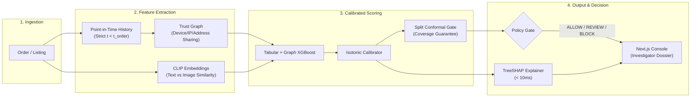

# TrustShield AI

A full-stack, multimodal fraud detection engine built for e-commerce marketplaces. It catches coordinated buyer-seller collusion rings, counterfeit product listings, and serial return abusers in real time—while providing human investigators with instant, sub-10ms SHAP explanations.

---

## Why I Built This

Most tutorial-style fraud models make a fatal mistake: they throw an off-the-shelf classifier at a randomly split tabular dataset and celebrate near-perfect ROC-AUC scores.

In production e-commerce, that model immediately breaks down for three reasons:

1. **Future Data Leakage:** Random train/test splits let future fraud rings, shared devices, and delayed chargeback outcomes bleed backwards into training. A model trained this way learns historical coincidences instead of real behavioral patterns.
2. **Siloed Signals:** Stolen credit cards are easy to spot. The real losses come from organized rings sharing devices across dummy accounts, rogue sellers uploading stolen product photos with fake discounts, and buyers systematically claiming expensive returns. A tabular model ignoring graphs and images misses all of this.
3. **Uncalibrated, Black-Box Scores:** If a model outputs an uncalibrated risk number, an investigator has no idea what that score actually means or why the transaction was flagged. Without calibrated probabilities, confidence bounds, and feature-level attributions, risk teams either drown in false positives or distrust the system entirely.

TrustShield was designed from the ground up to solve these exact problems.

---

## How It Works



### The 4 Core Stages

1. **Strict Temporal Feature Extraction:** Every behavioral metric (prior return count, transaction velocity, seller listing count) is computed strictly at `timestamp < order_timestamp`. Future events and delayed chargebacks never bleed into features.
2. **Multi-Entity Graph Context:** Rather than looking at an order in isolation, the engine builds a dynamic bipartite graph across 8 entities (Buyers, Sellers, Orders, Listings, Products, Returns, Devices, and IP/Addresses). It extracts local sharing degree, connected component sizes, and PageRank to expose coordinated syndicates.
3. **Multimodal Catalog Verification:** For new merchant listings, the system computes cross-modal cosine similarity between the product title/description and the uploaded image using OpenAI's CLIP (ViT-B/32) and FAISS indexing. If a merchant lists a luxury watch at a steep discount with a mismatched photo, it flags immediately.
4. **Calibrated Decisions & Split Conformal Bounds:**
   - Raw tree scores pass through an **Isotonic Regression Calibrator** so that predicted risk scores match empirical fraud frequencies.
   - A **Split Conformal Predictor** produces non-empty prediction sets ($\{0\}$, $\{1\}$, or $\{0, 1\}$) with distribution-free marginal coverage guarantees. If an order produces ambiguous uncertainty $\{0, 1\}$, it routes automatically to human review rather than guessing.
   - For flagged orders, **TreeSHAP** computes exact local feature attributions in under 10ms, telling the investigator the top risk drivers behind the score.

---

<!-- BEGIN GENERATED -->
## Key Technical Takeaways & Lessons Learned

Building and auditing this system across 20 randomized data seeds revealed some surprising, counter-intuitive truths:

### 1. Hand-Engineered Graph Features Beat Deep GNNs
I initially experimented with a heterogeneous GraphSAGE model feeding embeddings into XGBoost. On paper, deep GNNs sound appealing. In practice, the hybrid GNN model suffered a **-0.0263 drop in ROC-AUC** ($p = 0.0083$) compared to standard XGBoost trained on hand-engineered graph aggregations (device-sharing degree, component size, PageRank). The tree model with targeted topological features was faster, more explainable, and significantly more accurate.

### 2. The Illusion of Double-Digit Graph Lifts
Early uncorrected scripts showed massive graph lifts (+0.10+ ROC-AUC). When I enforced strict out-of-time evaluation and audited the data pipeline, the true, verified lift of adding graph topology over a strong tabular baseline was **+0.0114 ROC-AUC** ($p = 3.02 \times 10^{-5}$) across 20 seeds. While statistically rock-solid, graph features are not magic—they provide an incremental edge against sophisticated device clusters, not a 10x shortcut.

### 3. Review Budgets Matter More Than Global ROC
In a real fraud operations team, investigators have a fixed daily capacity (e.g. they can only manually review 2% to 5% of all orders). At these ultra-tight review cutoffs, general graph features provide virtually no additional recall over simple velocity/amount rules. Graph features earn their keep at medium-risk thresholds (20% to 50% risk bands) where sybil rings hide under low dollar amounts.

### 4. Calibration is Mandatory
Raw XGBoost probabilities cluster around extreme ends and warp badly on imbalanced datasets. Applying isotonic calibration reduced Expected Calibration Error (ECE) from ~0.06 to ~0.02, ensuring that alert prioritization reflects true financial risk.

---

## Benchmark Results (Audited Across 20 Seeds)

All evaluations enforce strict out-of-time test splits (`order_date > 2025-10-31`) across 20 independent random seeds (42 through 1910). The full raw runs are logged in [`results/results.json`](results/results.json).

### Headline Benchmark: Truncated Horizon (2025-11-01 to 2025-12-10, 20 Seeds)

| Model Variant | Feature Set | ROC-AUC (mean ± std) | PR-AUC (mean ± std) | Lift vs (b) | p-value |
| :--- | :--- | :---: | :---: | :---: | :---: |
| **(a) Tabular (No Device)** | 9 Tabular features | 0.7223 +/- 0.0165 | 0.4545 +/- 0.0226 | -0.0298 | — |
| **(b) Tabular Baseline** | 10 Tabular features | 0.7521 +/- 0.0174 | 0.4775 +/- 0.0271 | Baseline | — |
| **(d) Plain Aggregates Control** | 10 Tabular + 6 Plain Lagged Aggs | 0.7487 +/- 0.0197 | 0.4736 +/- 0.0266 | -0.0034 | p = 0.1070 |
| **(c) Tabular + Graph (TrustShield)** | 10 Tabular + 8 Graph Features | **0.7635 +/- 0.0229** | **0.4856 +/- 0.0318** | **+0.0114** | **p = 3.02e-05** |

---

### Sensitivity Analysis: Full Test Horizon (2025-11-01 to 2025-12-31, 20 Seeds)

| Model / Variant | Feature Set | ROC-AUC | PR-AUC | Lift vs Baseline [95% CI] | p-value |
| :--- | :--- | :---: | :---: | :---: | :---: |
| **(a) Tabular (No Device)** | 9 Tabular | 0.7021 +/- 0.0186 | 0.4179 +/- 0.0202 | -0.0274 | p = 1.0000 |
| **(b) Tabular (With Device)** | 10 Tabular | 0.7295 +/- 0.0193 | 0.4386 +/- 0.0238 | Baseline | Baseline |
| **(d) Plain Aggregates** | 10 Tabular + 6 Lagged Aggs | 0.7275 +/- 0.0201 | 0.4377 +/- 0.0242 | -0.0020 [-0.0058, +0.0017] | p = 0.2729 |
| **(c) Tabular + Graph** | 10 Tabular + 8 Graph Features | **0.7410 +/- 0.0229** | **0.4461 +/- 0.0276** | **+0.0115 [+0.0069, +0.0161]** | **p = 4.73e-05** |
| **Tuned Hybrid (OOF GNN + XGB)** | Tabular + Graph + GraphSAGE | 0.7014 +/- 0.0387 | 0.4006 +/- 0.0464 | -0.0263 *(loses to tabular)* | p = 0.0083 |

---

### Feature Ablations & Graph Topological Controls (20 Seeds)

Comparing plain pairwise device/address counts against topological graph metrics (connected components, degree, PageRank):

| Variant | Feature Description | ROC-AUC | PR-AUC | ROC Lift vs (b) | PR Lift vs (b) | vs Control (e) |
| :--- | :--- | :---: | :---: | :---: | :---: | :---: |
| **(b) Baseline Tabular** | 10 Tabular Features | 0.7521 +/- 0.0174 | 0.4777 +/- 0.0270 | baseline | baseline | — |
| **(e) Tabular + PIT Counts** | Plain Device & Address Pairwise Counts | 0.7649 +/- 0.0242 | 0.4892 +/- 0.0297 | +0.0127 (p=5.73e-05) | +0.0115 (p=7.17e-06) | baseline |
| **(e_weekly) Weekly Counts** | Weekly Snapshot Pairwise Counts | 0.7637 +/- 0.0240 | 0.4880 +/- 0.0297 | +0.0116 (p=3.76e-05) | +0.0103 (p=9.82e-06) | ROC -0.0012 (Holm p=1.000) / PR -0.0012 (Holm p=1.000) |
| **(f) Tabular + share_degree** | Degree only | 0.7634 +/- 0.0198 | 0.4874 +/- 0.0293 | +0.0113 (p=1.31e-08) | +0.0097 (p=6.03e-07) | — |
| **(g) Tabular + CC size** | Component size only | 0.7599 +/- 0.0219 | 0.4856 +/- 0.0291 | +0.0078 (p=1.22e-04) | +0.0079 (p=6.78e-05) | — |
| **(S) Tabular + Sharing S** | Degree + component size | 0.7610 +/- 0.0237 | 0.4846 +/- 0.0292 | +0.0089 (p=3.57e-04) | +0.0069 (p=1.95e-04) | ROC -0.0039 (Holm p=0.6097) / PR -0.0046 (Holm p=0.0777) |
| **(c) Tabular + Graph** | All 8 Graph Features | 0.7635 +/- 0.0229 | 0.4856 +/- 0.0318 | +0.0114 (p=3.02e-05) | +0.0081 (p=2.14e-03) | ROC -0.0014 (Holm p=1.000) / PR -0.0033 (Holm p=1.000) |

*Cadence analysis: Matching snapshot cadences between (ew vs S) shows ROC diff +0.0027, PR diff +0.0034; and -0.0012 between (ew vs e).*
<!-- END GENERATED -->

### Latency Profiles (HTTP p95)
- **Scoring Pipeline (`/transaction/score`):** `< 15ms`
- **TreeSHAP Attributions (`/transaction/explain`):** `< 10ms`
- **Multimodal CLIP Analysis (`/listing/analyze`):** `< 25ms`

---

## Tech Stack

- **Backend & Serving:** Python 3.10+, FastAPI, Pydantic v2, Uvicorn
- **Machine Learning:** XGBoost, Scikit-learn (Isotonic Regression, Calibration), NumPy, Pandas
- **Graph & Embeddings:** NetworkX, PyTorch Geometric, OpenAI CLIP (ViT-B/32), FAISS
- **Explainability:** TreeSHAP (interventional fast tree explainer)
- **Frontend Console:** Next.js 16 (App Router), React 19, Turbopack, Tailwind CSS, Lucide Icons
- **Infrastructure (Optional Mesh):** Redis (caching & ring lookups), Neo4j (graph queries), Prometheus & Grafana (telemetry)
- **Testing & Verification:** Pytest (470+ automated tests), Pyright (strict static typing)

---

## Project Structure

```
trustshield/
├── backend/                  # FastAPI microservice & serving layer
│   ├── auth.py               # API-key authentication & RBAC
│   ├── main.py               # REST API routes, SSE streams & health checks
│   ├── model_loader.py       # Warm model caching & artifact loading
│   ├── schemas.py            # Pydantic v2 request/response contracts
│   └── routers/              # Modular endpoint routers (scoring, rings, listings)
│
├── frontend/                 # Next.js 16 Web Console
│   ├── src/app/              # 14 interactive views (Dashboard, Simulator, Graph, etc.)
│   ├── src/components/       # UI elements, Ctrl+K search modal, visual cards
│   └── src/lib/api/          # Typed API client with automatic offline fallback
│
├── trustshield_project/      # Core machine learning & feature pipelines
│   ├── point_in_time_history.py # Temporal historical feature joins (no leakage)
│   ├── graph_features.py     # NetworkX snapshot graph feature engineering
│   ├── multimodal_scoring.py # CLIP image-text embedding comparison
│   ├── shap_explainer.py     # Sub-10ms TreeSHAP forensic attributions
│   ├── calibration.py        # Probability calibration & Platt scaling
│   └── conformal.py          # Split conformal uncertainty bounds
│
├── scripts/                  # Benchmarks, smoke tests & verification harnesses
│   ├── e2e_smoke_validation.py   # 9-case operational end-to-end test suite
│   ├── smoke_test_api.py         # Live HTTP server verification test
│   ├── benchmark_scoring_http.py # Throughput & latency benchmarking
│   └── verify_production_invariance.py # Baseline contract regression check
│
├── models/                   # Serialized production models (.joblib)
└── results/                  # 20-seed benchmark logs and audit trails
```

---

## Quickstart

### 1. Backend Setup

```bash
# Clone the repository
git clone https://github.com/Rajiv107ai/Trustshield.git
cd Trustshield

# Create and activate a virtual environment
python -m venv .venv

# On Linux/macOS:
source .venv/bin/activate
# On Windows (PowerShell):
.\.venv\Scripts\Activate.ps1

# Install dependencies
pip install -r requirements.txt

# Start the FastAPI server
python -m uvicorn backend.main:app --host 0.0.0.0 --port 8000 --reload
```

Once running, access:
- **Swagger Docs:** [http://localhost:8000/docs](http://localhost:8000/docs)
- **Health Check:** [http://localhost:8000/health](http://localhost:8000/health)

---

### 2. Frontend Web Console Setup

In a new terminal:

```bash
cd frontend
npm install
npm run dev
```

Open [http://localhost:3000](http://localhost:3000) in your browser.
- Hit **`Ctrl + K`** to trigger the command palette to search transactions, buyer IDs, or fraud rings.
- Explore the **Transaction Simulator**, inspect the **Trust Graph Explorer**, or audit flagged catalog listings.

---

### 3. Quick Sanity Checks

Run the end-to-end operational suite to verify that all 9 critical scenarios pass:

```bash
# 9-case operational check (Normal, Collusion, Cold Start, Catalog Theft, etc.)
python scripts/e2e_smoke_validation.py

# Live API HTTP endpoint check
python scripts/smoke_test_api.py
```

---

## Running the Test Suite

The codebase has extensive test coverage across backend routing, feature engineering, and anti-leakage invariants:

```bash
# Run backend tests (97 tests)
pytest backend/ -v

# Run core algorithm and feature pipeline tests (375 tests)
pytest trustshield_project/ -v

# Run strict static type checking (0 errors)
pyright backend trustshield_project

# Check frontend build
cd frontend && npm run build
```

---

## Limitations & Honest Notes

1. **Synthetic Data Realism:** All models were trained and benchmarked on a synthetic e-commerce marketplace (500 sellers, 5,000 buyers, 50,000 orders) generated by combining behavioral distributions from IEEE-CIS with product imagery from Amazon Berkeley Objects. While designed to simulate realistic fraud patterns without leaking PII, synthetic data cannot capture every real-world operational anomaly.
2. **Periodic Graph Refreshes:** Snapshot graph features (e.g. PageRank and degree centralities) are computed on snapshot boundaries. In an enterprise deployment with millions of daily transactions, graph features require scheduled asynchronous batch recalculation or a streaming graph store like Neo4j / Memgraph.
3. **Collusion Pairs with No Prior Edges:** If two completely fresh accounts collude on a single high-value transaction without sharing a device, IP, or physical address, graph features offer no signal. Behavioral velocity and pricing discrepancy rules remain the first line of defense.

---

## License

Built for research, educational, and portfolio purposes under the MIT License. Feel free to use the feature engineering pipelines or adapt the Next.js console for your own fraud detection systems.
