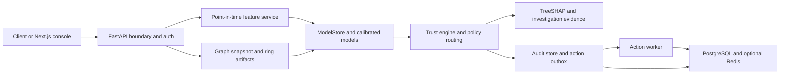

# TrustShield AI

TrustShield is an e-commerce fraud-intelligence platform that combines machine learning, point-in-time history, relationship signals, listing analysis, and investigation tooling in one system.

The project is built around a simple idea: a fraud score is only useful when the data was available at decision time, the result can be explained, and the surrounding operations workflow can be trusted. TrustShield therefore treats temporal leakage, feature ownership, calibration, auditability, and deployment readiness as first-class engineering concerns.

This repository contains the full platform:

- a Python intelligence layer for transaction, listing, return, graph, calibration, and explanation workloads;
- a FastAPI serving layer with authentication, readiness checks, monitoring, action handling, and versioned contracts;
- a Next.js operations console for analysts and operators;
- deterministic synthetic data and audited evaluation reports;
- Docker and Docker Compose deployment files;
- CI guards for API contracts, benchmark provenance, release artifacts, and production invariance.

> **Project status:** TrustShield is a production-oriented prototype and staging candidate. It is not a claim of live fraud-prevention performance. The current evaluation is based primarily on controlled synthetic marketplace data, and real deployment still requires live shadow scoring, matured labels, approved SLOs, and operational sign-off.

---

## What TrustShield does

TrustShield supports several related trust and safety workflows:

### Transaction risk scoring

The primary transaction path combines:

- buyer, seller, order, return, amount, price, and account-age signals;
- strict point-in-time historical aggregates;
- device and address sharing signals;
- graph topology features such as sharing degree, component size, PageRank, HHI concentration, and pair history;
- calibrated fraud probabilities when the calibration artifact is available;
- uncertainty and detector-disagreement signals;
- an operational policy that routes cases to `ALLOW`, `REVIEW`, `HOLD`, or `BLOCK`;
- reason codes, evidence availability, and optional TreeSHAP explanations.

The server owns the derived feature boundary in production. Client-supplied feature values are treated as inputs for validation or local development and are overridden by server-side feature resolution when governed data is available.

### Fraud-ring and relationship intelligence

The project builds and queries multi-entity relationships across buyers, sellers, orders, listings, products, returns, devices, and address or network identifiers. The serving path uses precomputed graph artifacts and point-in-time graph features rather than an always-on graph database.

Available relationship signals include:

- shared-device and shared-address degree;
- connected-component size;
- buyer and seller relationship degree;
- buyer and seller PageRank;
- seller-buyer concentration using HHI;
- point-in-time buyer-seller edge history;
- ranked candidate fraud rings and their member entities.

The packaged graph is a snapshot. Its effective date and freshness status are exposed by the model loader and readiness diagnostics. A stale snapshot is reported explicitly instead of being presented as current.

### Listing integrity analysis

The listing path evaluates price anomalies, seller history, and text-image or product-image similarity. When the optional CLIP cache is available, the service can score cached product embeddings. It can fall back to a TF-IDF-style multimodal surrogate or a caller-supplied similarity value when CLIP is unavailable.

This path is separate from transaction scoring. Optional CLIP support is used for listing analysis; the retired Phase 5/GNN transaction-serving path is not the authoritative production scorer.

### Return-abuse analysis

The return detector evaluates return velocity, buyer and seller return history, account age, order amount, and return reason features. It produces a calibrated-style risk output, policy decision, and reason codes for operational review.

### Investigation and dispute support

TrustShield can generate structured investigation dossiers and copilot-style dispute briefs. These responses separate:

1. observed evidence;
2. model inference;
3. graph findings;
4. recommended human action.

The dossier pipeline includes provenance metadata and a grounding verification guard. When an external language model is not configured, the project uses deterministic rule-grounded synthesis instead of pretending that generated text is independently verified evidence.

---

## Why the project is designed this way

Many fraud prototypes look strong because they make assumptions that do not survive production:

- random splits allow future events to leak into training;
- caller-provided fraud features can be changed by an untrusted client;
- raw classifier scores are treated as probabilities without calibration;
- graph features are described as live even when they come from a static snapshot;
- an HTTP action response is treated as provider-side success before the provider has confirmed it;
- demo data and live data are shown with the same visual treatment.

TrustShield addresses these issues directly. It does not try to hide the limitations of the current benchmark. In particular, the audited experiments show a modest graph lift rather than a dramatic one, and the current synthetic generator does not provide a meaningful seller-buyer-collusion signal.

---

## Active architecture



### Runtime boundaries

#### Intelligence layer

The intelligence code lives in `core/` and `trustshield_project/`. The packaged `trustshield_project/` modules are imported by the serving layer. The main areas are:

- `advanced_trust_engine.py` — canonical trust scoring, uncertainty, and decision routing;
- `point_in_time_history.py` and `temporal_utils.py` — strict historical cutoffs;
- `graph_features.py` — NetworkX topology and graph feature extraction;
- `calibration.py` — probability calibration and calibration metrics;
- `specialized_fraud_detectors.py` — fake-listing and return-abuse detectors;
- `multimodal_scoring.py` — CLIP cache handling and multimodal similarity scoring;
- `shap_explainer.py` — exact local TreeSHAP attributions;
- `dossier_generator.py` — evidence-grounded forensic narratives;
- `policy_config.py` and `policy_rules.py` — centralized policy decisions and reason codes;
- synthetic generators and robustness utilities — entities, orders, listings, returns, fraud injection, bootstrap evaluation, and sensitivity analysis.

#### FastAPI serving layer

The `backend/` package provides:

- application startup and lifespan model loading;
- Pydantic request and response contracts;
- API-key or Bearer-token authentication;
- role checks for operator and admin actions;
- server-side feature resolution;
- model, calibrator, graph, ring, catalog, CLIP, and TreeSHAP loading;
- health, readiness, version, and metrics endpoints;
- transaction, listing, return, graph, investigation, feature, monitoring, action, contract, and champion-challenger routers;
- durable audit and action-outbox services;
- provider adapter interfaces and deterministic development fakes.

#### Frontend operations console

The `frontend/` package is a Next.js App Router application using React, TypeScript, and Tailwind CSS. It has separate live and demo paths and exposes the following screens:

| Route | Purpose |
| --- | --- |
| `/dashboard` | Command center with readiness, volume, decisions, and flagged work |
| `/transactions` | Transaction risk analyzer and scenario simulator |
| `/transactions/feed` | Transaction stream and filtering view |
| `/fraud-rings` | Ranked relationship clusters and ring intelligence |
| `/trust-graph` | Multi-entity graph exploration and timeline context |
| `/listings` | Listing and image-text integrity analysis |
| `/returns` | Return-abuse analysis |
| `/investigations` | Evidence-grounded dossiers and investigator workflows |
| `/models` | Model provenance, calibration, and model status |
| `/evaluation` | Benchmark, ablation, and operating-point views |
| `/monitoring` | Health, readiness, drift, calibration, and service telemetry |
| `/settings` | API URL, session key, demo mode, and user preferences |

The global command palette is available with `Ctrl+K` on Windows and Linux, or `Cmd+K` on macOS.

---

## Core engineering principles

### Point-in-time correctness

Historical features use strict `event_time < decision_time` semantics. Orders, returns, device events, account history, and pair history are filtered to what was observable before the scoring event. This rule is applied in both offline evaluation and the governed serving feature service.

### Server-owned security features

In production, the caller should not be able to replace buyer history, return history, device-sharing features, or graph features with arbitrary values. The backend resolves those values from its configured history and graph sources and reports whether evidence came from the server or from a fallback path.

### Calibration and uncertainty

The system can expose raw and calibrated fraud probabilities, confidence, predictive uncertainty, detector disagreement, and conformal prediction sets. The audited conformal results are documented as an evaluation diagnostic; they should not be interpreted as a universal production guarantee for every future distribution.

### Explainability for operations

TreeSHAP attributions are split into risk amplifiers and protective factors. Investigation responses also include human-readable evidence, graph context, policy guidance, and provenance rather than only returning a model score.

### Durable actions instead of false success

Operational actions are first written to an action outbox. The HTTP request returns a durable receipt, not a claim that an external provider has already succeeded. The worker processes pending commands, records provider receipts, retries timeouts with the same idempotency key, and keeps failed or unknown outcomes visible.

### Fail-closed production controls

Production startup and readiness can require:

- explicit API keys with minimum strength;
- non-wildcard CORS origins;
- authentication enabled with no development bypass;
- point-in-time history;
- a valid release manifest;
- complete governed feature-service sources;
- durable PostgreSQL-backed audit and action storage;
- a graph snapshot within the configured freshness window.

Development can use local SQLite and deterministic adapters, but those shortcuts are not silently promoted to production.

---

## Policy decisions

The canonical engine routes calibrated risk into four operational outcomes:

| Decision | Meaning |
| --- | --- |
| `ALLOW` | Continue the normal flow |
| `REVIEW` | Send the case to an investigator queue |
| `HOLD` | Pause or challenge the transaction while evidence is collected |
| `BLOCK` | Reject or contain the transaction according to the approved policy |

Thresholds live in `trustshield_project/policy_config.py`. They should be changed through a reviewed rolling deployment, not by silently changing an environment variable in a running process. `HOLD` and `REVIEW` cases are intended for human operations workflows, and autonomous enforcement should remain subject to the deployment's approved governance policy.

---

## API surface

The complete OpenAPI contract is available at `/docs` when the backend is running. The main routes are grouped below.

### Scoring and explanations

| Method | Route | Purpose |
| --- | --- | --- |
| `POST` | `/transaction/score` | Score an order and return risk, policy, evidence, and uncertainty fields |
| `POST` | `/transaction/explain` | Return TreeSHAP drivers and an investigator narrative |
| `POST` | `/listing/analyze` | Score listing or image-text mismatch risk |
| `POST` | `/return/analyze` | Score return-abuse risk |
| `POST` | `/return/score` | Backward-compatible alias for return analysis |

### Investigations, graph intelligence, and streaming

| Method | Route | Purpose |
| --- | --- | --- |
| `GET` | `/fraud-rings` | Return ranked candidate fraud rings |
| `POST` | `/investigation/generate-dossier` | Generate an evidence-grounded dossier |
| `POST` | `/investigation/copilot/analyze` | Run the investigation copilot workflow |
| `POST` | `/investigation/copilot/verify-brief` | Verify a signed dispute brief |
| `GET` | `/stream/transactions` | Serve the deterministic SSE transaction stream |

The transaction stream is a simulation stream built from fixed seed templates. It is useful for demonstrations and UI testing, but it is not a live marketplace feed.

### Feature diagnostics

| Method | Route | Purpose |
| --- | --- | --- |
| `GET` | `/features/status` | Show feature-service readiness and indexed sources |
| `POST` | `/features/preview` | Preview authoritative point-in-time features |
| `GET` | `/features/buyer/{buyer_id}` | Show buyer history and velocity windows |
| `GET` | `/features/device/{device_id}` | Show device-sharing activity |

### Monitoring and system diagnostics

| Method | Route | Purpose |
| --- | --- | --- |
| `GET` | `/health` | Liveness and loaded-component status |
| `GET` | `/ready` | Readiness, degraded state, source completeness, and freshness details |
| `GET` | `/version` | Application and release-manifest provenance |
| `GET` | `/metrics` | Prometheus-compatible request and service metrics |
| `GET` | `/monitoring/drift` | Aggregate feature, score, and decision drift |
| `GET` | `/monitoring/calibration` | Matured-label calibration report |
| `GET` | `/monitoring/overview` | Combined monitoring status and alerts |
| `GET` | `/monitoring/reports` | Historical monitoring reports |
| `GET` | `/system/benchmark` | Admin-only local benchmark information |

### Contracts, actions, and model comparison

| Method | Route | Purpose |
| --- | --- | --- |
| `POST` | `/contracts/events/validate` | Validate an event contract |
| `POST` | `/contracts/labels/validate` | Validate a delayed-label contract |
| `POST` | `/actions/transactions/{order_id}/approve` | Enqueue an approval action |
| `POST` | `/actions/transactions/{order_id}/hold` | Enqueue a hold action |
| `POST` | `/actions/transactions/{order_id}/block` | Enqueue a block action |
| `POST` | `/actions/listings/{listing_id}/quarantine` | Enqueue a listing quarantine |
| `POST` | `/actions/rings/{ring_id}/freeze` | Enqueue a ring freeze action |
| `GET` | `/actions/{action_id}` | Read a pending or completed action receipt |
| `GET` | `/models/champion-challenger/status` | Read champion and challenger status |
| `POST` | `/models/champion-challenger/configure` | Configure `SHADOW`, `AB_SPLIT`, or `CANARY` mode |
| `POST` | `/models/champion-challenger/score-dual` | Compare both models on one transaction |
| `GET` | `/models/champion-challenger/disagreements` | Read recent disagreements |
| `POST` | `/models/champion-challenger/reset-metrics` | Reset comparison telemetry |

Protected routes accept an `X-API-Key` header or a Bearer token. Operator and admin dependencies protect mutating and investigation operations.

---

## Data, artifacts, and evaluation

### Synthetic marketplace data

The default repository data is generated by the simulation code rather than copied from a customer system. It includes marketplace entities, order history, return events, products, sellers, buyers, device mappings, address or sharing relationships, and injected fraud scenarios.

The main serving-time data directory is:

```text
data/synthetic_v2_1/
```

The Docker build intentionally includes the serving CSVs needed by the governed feature service while keeping unrelated research data out of the image context. Required production sources are tracked as:

```text
orders
buyers
sellers
returns
device_mapping
```

The product catalog is loaded from `models/product_catalog.parquet` when it is available.

### Model and serving artifacts

The root `models/` directory contains serialized artifacts used by the serving layer. The main files are:

| Artifact | Role |
| --- | --- |
| `combined_graph_model.joblib` | Authoritative transaction model using tabular and graph features |
| `fake_listing_model.joblib` | Fake-listing detector |
| `return_fraud_model.joblib` | Return-abuse detector |
| `fraud_rings.joblib` | Precomputed candidate ring table |
| `feature_meta.joblib` | Feature columns and model metadata |
| `calibrator.joblib` | Probability calibration artifact when present |
| `graph_snapshot.joblib` | Static graph topology snapshot and effective date |
| `phase3_val_predictions.npy` | Validation predictions used for conformal calibration |
| `phase3_val_labels.npy` | Validation labels paired with the conformal calibration scores |
| `product_catalog.parquet` | Product and category pricing reference |
| `clip_cache/` | Optional cached text and image embeddings |
| `release_manifest.json` | Release-time artifact and provenance manifest |

The loader treats the Phase 3 serving artifacts as required. CLIP artifacts are optional and can degrade the listing feature surface without preventing the core transaction model from loading, subject to deployment policy.

### Audited findings

The benchmark is deliberately reported with both predictive and operational context. The graph model is not presented as a magic replacement for the tabular baseline.

<!-- BEGIN GENERATED -->
## Audited benchmark snapshot

The canonical evaluation uses twenty independent seeds and chronological holdout data after the graph cutoff. The full details and provenance are maintained in [`results/RESULTS.md`](results/RESULTS.md) and [`results/results.json`](results/results.json).

| Measurement | Audited result |
| --- | ---: |
| Full-horizon tabular baseline ROC-AUC | 0.7295 mean |
| Full-horizon tabular plus graph ROC-AUC | 0.7410 mean |
| Full-horizon graph lift | +0.0115 ROC-AUC |
| Truncated Variant (a) ROC | 0.7223 |
| Truncated Variant (a) PR | 0.4545 |
| Truncated-horizon tabular baseline ROC-AUC | 0.7521 mean |
| Truncated Variant (b) PR | 0.4775 |
| Truncated-horizon tabular plus graph ROC-AUC | 0.7635 mean |
| Truncated Variant (c) PR | 0.4856 |
| Truncated Variant (d) ROC | 0.7487 |
| Truncated Variant (d) PR | 0.4736 |
| Truncated-horizon graph lift | +0.0114 ROC-AUC |
| Hybrid GNN lift in the tested configuration | -0.0263 ROC-AUC |
| Mondrian overall coverage | 95.12% |
| Mondrian legitimate-class coverage | 95.30% |
| Mondrian fraud-class coverage | 93.14% |
| Mondrian mean prediction-set size | 1.7430 |

What these results mean:

- Hand-engineered point-in-time sharing features beat the tested GNN-plus-tree hybrid.
- The graph contribution is statistically measurable but modest.
- At very tight manual-review budgets, graph features do not show a reliable operational lift in the current synthetic benchmark.
- The seller-buyer-collusion scenario is effectively at chance because the generator rarely reuses the same buyer-seller burst edge.
- The conformal report is an audited diagnostic. Fraud-class coverage is below the nominal target, so the result must not be described as a universal guarantee.
<!-- END GENERATED -->

The project also contains robustness, sensitivity, right-censoring, control-variant, ring-recovery, and review-budget analyses. These are kept in generated result files rather than copied manually into multiple documents.

---

## Repository layout

```text
TrustShield/
├── backend/                         FastAPI application and serving services
│   ├── auth.py                      API-key authentication and role checks
│   ├── features.py                  Server-owned feature boundary
│   ├── model_loader.py              Artifact loading and readiness metadata
│   ├── schemas.py                   Pydantic request and response contracts
│   ├── release_manifest.py           Release provenance validation
│   ├── routers/                     Scoring, operations, monitoring, actions, contracts
│   ├── services/                    Feature, audit, outbox, drift, calibration, copilot
│   ├── adapters/                    Payment, identity, marketplace, graph, and fake adapters
│   └── contracts/                   Versioned event, label, action, audit, and monitoring schemas
├── core/                            Intelligence modules and core research documentation
├── trustshield_project/             Packaged runtime and research modules imported by the backend
├── frontend/                        Next.js and React operations console
│   ├── src/app/                     Dashboard, transaction, graph, listing, return, model, and ops screens
│   ├── src/components/              Shared console UI and interaction components
│   └── src/lib/api/                 Typed API client and deterministic demo adapter
├── data/synthetic_v2_1/             Synthetic serving-time marketplace data
├── models/                          Serialized models, calibration, graph, ring, catalog, and CLIP artifacts
├── scripts/                         Training, data, worker, release, verification, and smoke-test tools
├── tests/                           Domain-organized API, core, service, reliability, and load tests
├── docs/                            Model card, deployment, operations, reliability, and governance docs
├── results/                         Generated benchmark JSON and scientific reports
├── Dockerfile                       Multi-stage backend image
├── docker-compose.yml               API, worker, PostgreSQL, and Redis development/deployment stack
├── .env.example                     Environment configuration template
├── pyproject.toml                   Python package metadata
├── requirements.txt                 Runtime dependencies
├── requirements-clip.txt            Optional CLIP integration dependencies
├── requirements-dev.txt             Test and development dependencies
└── pytest.ini                       Test discovery and CLIP marker configuration
```

---

## Local development

### Prerequisites

- Python 3.12 or newer;
- Node.js 20 or newer and npm;
- Docker Desktop or another Docker-compatible runtime for the Compose stack;
- optional CLIP dependencies and the external image dataset for CLIP integration tests.

### Start the backend

From the repository root:

```bash
python -m venv .venv

# macOS/Linux
source .venv/bin/activate

# Windows PowerShell
.\.venv\Scripts\Activate.ps1

python -m pip install --upgrade pip
python -m pip install -r requirements.txt -r requirements-dev.txt
```

Copy the environment template if you want local overrides:

```bash
# macOS/Linux
cp .env.example .env

# Windows PowerShell
Copy-Item .env.example .env
```

Start the API:

```bash
uvicorn backend.main:app --host 0.0.0.0 --port 8000 --reload
```

Useful local URLs:

- Swagger UI: `http://localhost:8000/docs`
- ReDoc: `http://localhost:8000/redoc`
- liveness: `http://localhost:8000/health`
- readiness: `http://localhost:8000/ready`
- release/version information: `http://localhost:8000/version`
- metrics: `http://localhost:8000/metrics`

The development authentication defaults are documented in `.env.example`. For the frontend, enter the active API key in the Settings screen or use explicit Demo Mode.

### Start the frontend

In another terminal:

```bash
cd frontend
npm ci
npm run dev
```

Open `http://localhost:3000`. Set `NEXT_PUBLIC_API_URL` in `frontend/.env.local` when the API is not running at the default local address.

The frontend distinguishes live backend responses from deterministic offline demo responses. Demo mode is useful for presentations and UI development, but it never sends operational actions to the backend.

### Start the action worker

For local action-outbox processing:

```bash
python scripts/run_action_worker.py --poll-interval 2.0
```

The worker processes pending commands after they have been durably enqueued. In production, configure the PostgreSQL action DSN and run the worker as a separate service.

---

## Docker Compose

The Compose file defines the backend platform services:

- `trustshield-api` — FastAPI inference and operations API;
- `action-worker` — durable action-outbox worker;
- `postgres` — durable audit and action storage;
- `redis` — optional distributed sliding-window and cache backend.

The Next.js frontend is built and run separately; it is not a service in the current `docker-compose.yml`.

Start the backend stack:

```bash
cp .env.example .env
docker compose up -d --build
```

On Windows PowerShell, use `Copy-Item .env.example .env` before the Compose command.

Inspect status and logs:

```bash
docker compose ps
```

Check the probes:

```bash
curl -f http://localhost:8000/health
curl -f http://localhost:8000/ready
```

The Docker image is multi-stage, runs as a non-root user, packages the application and model artifacts, includes the serving-time synthetic feature tables, and uses `/ready` for its container healthcheck.

---

## Configuration

The complete development template is in [`.env.example`](.env.example). The following settings are the ones most likely to matter when moving from local development to a controlled deployment.

| Variable | Purpose |
| --- | --- |
| `TRUSTSHIELD_ENV` | Selects `development` or `production` behavior |
| `TRUSTSHIELD_AUTH_ENABLED` | Authentication toggle; production cannot disable auth |
| `TRUSTSHIELD_API_KEY` | Operator or scoring API key |
| `TRUSTSHIELD_ADMIN_KEY` | Admin API key |
| `CORS_ALLOWED_ORIGINS` | Explicit browser-origin allowlist |
| `TRUSTSHIELD_REQUIRE_PIT_HISTORY` | Require point-in-time history before readiness |
| `TRUSTSHIELD_STRICT_SERVER_FEATURES` | Reject caller-controlled derived features |
| `TRUSTSHIELD_FEATURE_SERVICE_READY` | Explicit permission to use the governed feature service; runtime readiness is also checked |
| `TRUSTSHIELD_GRAPH_MAX_STALE_DAYS` | Maximum allowed graph snapshot age before stale status is reported |
| `TRUSTSHIELD_REQUIRE_RELEASE_MANIFEST` | Require release-manifest validation |
| `TRUSTSHIELD_RELEASE_MANIFEST_PATH` | Manifest location |
| `TRUSTSHIELD_RELEASE_COMMIT` | Expected release commit when supplied by deployment |
| `TRUSTSHIELD_AUDIT_DECISIONS` | Persist allowlisted transaction decision snapshots |
| `TRUSTSHIELD_REQUIRE_AUDIT_DURABILITY` | Require durable audit storage |
| `TRUSTSHIELD_AUDIT_POSTGRES_DSN` | PostgreSQL DSN for audit records |
| `TRUSTSHIELD_ACTION_POSTGRES_DSN` | PostgreSQL DSN for the action outbox |
| `TRUSTSHIELD_AUDIT_SQLITE_PATH` | Development SQLite audit path |
| `TRUSTSHIELD_ACTION_OUTBOX_SQLITE_PATH` | Development SQLite outbox path |
| `TRUSTSHIELD_REDIS_URL` or `REDIS_URL` | Optional Redis sliding-window backend |
| `TRUSTSHIELD_DEPLOYMENT_MODE` | Champion-challenger mode: `SHADOW`, `AB_SPLIT`, or `CANARY` |
| `TRUSTSHIELD_TRAFFIC_SPLIT_PCT` | Challenger traffic share when the deployment mode uses a split |
| `CLIP_ENABLED` | Enable or disable optional CLIP listing scoring |

### Production configuration rules

When `TRUSTSHIELD_ENV=production`, the application is intended to fail closed if:

- authentication is disabled or the development bypass is enabled;
- API keys are missing or too weak;
- CORS is empty or contains a wildcard;
- required point-in-time history is unavailable;
- the release manifest is required but missing or invalid;
- the governed feature service is incomplete;
- durable audit or action storage is required but unavailable.

Production should use PostgreSQL for audit and action persistence. Local SQLite is for development and tests. The optional Redis backend improves distributed sliding-window support, but the feature service also has an in-memory implementation for local operation and deterministic tests.

---

## Release and deployment workflow

TrustShield treats a release as a specific combination of source commit, model artifacts, feature schema, dependency locks, and runtime metadata.

### Build and verify a release manifest

Run this from the exact checkout that will be packaged:

```bash
python scripts/build_release_manifest.py --output models/release_manifest.json
python scripts/verify_release_gate.py \
  --manifest models/release_manifest.json \
  --benchmark models/http_benchmark_results.json
```

The manifest records hashes and metadata for required serving artifacts and dependency lock files. A dirty working tree, missing artifact, hash mismatch, or commit mismatch should block a production release.

### Build the backend image

```bash
docker build -t trustshield-api:local .
docker compose config
docker compose up -d --build
```

### Verify the running service

At minimum, verify:

```bash
curl -f http://localhost:8000/health
curl -f http://localhost:8000/ready
curl -f http://localhost:8000/version
```

Then run smoke checks for transaction scoring, listing analysis, return analysis, the action enqueue/status path, and the frontend-to-backend contract.

### Canary and rollback model

The repository supports champion-challenger comparison in `SHADOW`, `AB_SPLIT`, and `CANARY` modes. The intended rollout sequence is:

1. keep the current Phase 3 model as the champion;
2. score the challenger in shadow mode;
3. compare decisions, risk differences, conformal sets, and latency;
4. use a small canary only after the shadow results are reviewed;
5. retain the previous image and release manifest for rollback;
6. reconcile pending provider actions by idempotency key before retrying them.

Rollback should restore an immutable image and its manifest. It should not overwrite model files inside a running container.

---

## Testing and quality gates

The default pytest configuration excludes heavyweight CLIP integration tests. This keeps the normal suite deterministic and avoids downloading external image data during every run.

### Python tests

```bash
# Default suite; CLIP-marked tests are excluded by pytest.ini
pytest tests/ -q

# Core intelligence tests without CLIP integration tests
pytest tests/core/ -m "not clip" -q

# API, service, and reliability tests
pytest tests/api/ tests/services/ tests/reliability/ -q

# Run CLIP tests explicitly when their dependencies and image data are available
pytest -m clip -q
```

### Verification scripts

```bash
# Recompute and verify generated benchmark claims
python scripts/verify_results.py

# Check offline and online production response parity
python scripts/verify_production_invariance.py

# Check that docs and UI metrics are grounded in the canonical results file
python scripts/check_no_hardcoded_metrics.py

# Check frontend/backend OpenAPI alignment
python scripts/check_openapi_contract.py

# Run the deterministic API smoke validation
python scripts/e2e_smoke_validation.py
```

### Static and frontend checks

```bash
flake8 backend core trustshield_project scripts \
  --count --select=E9,F63,F7,F82 --show-source

npx --yes pyright

cd frontend
npm ci
npm run lint
npx tsc --noEmit
npm run build
```

### CI pipeline

The GitHub Actions workflow in [`.github/workflows/ci.yml`](.github/workflows/ci.yml) covers:

- critical Flake8 syntax and name-resolution checks;
- Pyright analysis;
- core and serving-layer pytest suites;
- metric-grounding checks;
- failure-injection tests;
- OpenAPI contract verification;
- release manifest construction and verification;
- benchmark consistency verification;
- production invariance verification;
- frontend dependency installation, lint, and production build;
- Docker image build verification.

### Recent focused verification

The current working-tree verification reported:

- API, service, and reliability tests: `225 passed`;
- core tests excluding CLIP: `224 passed, 2 skipped`;
- benchmark consistency verification: passed;
- production invariance: all `4` scenarios passed the `29`-field comparison.

Environment-dependent checks such as a clean frontend install, Docker build, external database restore, staging load test, and canary observation still need to be executed in the deployment environment before a production promotion.

---

## Reproducing the research pipeline

The repository contains scripts for generating data, training models, refreshing graph and ring artifacts, building CLIP caches, and regenerating reports. The exact order depends on which artifact is being refreshed, but a typical research cycle is:

```bash
# Generate or refresh the v2.1 synthetic marketplace data
python scripts/generate_realistic_synthetic_data_v2_1.py

# Train and serialize the model artifacts
python scripts/train_and_save_models.py

# Refresh graph/ring evaluation artifacts when the data or cutoff changes
python scripts/evaluate_naive_connected_components_20seeds.py

# Build the optional listing embedding cache
python scripts/build_clip_embeddings.py

# Recompute generated result reports and verify the published claims
python scripts/verify_results.py
```

Script names and arguments can change as the research workflow evolves. Check a script's `--help` output before running a long job. Model artifacts should be regenerated together with their feature metadata, validation arrays, graph snapshot, and release manifest rather than copied independently.

---

## Known limitations

These limitations are part of the current project status, not hidden implementation details:

1. **Synthetic evaluation data.** The benchmark demonstrates the behavior of the pipeline and its leakage controls. It is not evidence of production fraud savings or generalization to a different marketplace.
2. **Static graph topology.** The graph snapshot must be refreshed on a schedule. The freshness gate reports stale topology, but deployment owners still need to rebuild and promote a new snapshot.
3. **Optional CLIP capability.** Real CLIP listing scoring depends on the cached embeddings and compatible optional dependencies. The listing route has fallbacks, and the response identifies which scoring path was used.
4. **Simulated transaction stream.** The SSE route uses fixed seed templates. It is not a connection to a live order bus.
5. **Conformal coverage is not universal.** The audited fraud-class coverage is below the nominal target, and the results report correctly labels the mechanism as an offline diagnostic.
6. **Limited operational evidence.** The repository includes deterministic failure-injection tests and configurable load scenarios, but it does not claim that a managed database restore, provider reconciliation, staging load test, or canary window has been executed by CI.
7. **GNN serving is retired.** The tested GNN-plus-tree hybrid underperformed the hand-engineered graph feature path, so it is retained as a research finding rather than an active transaction-serving dependency.
8. **Human governance remains necessary.** `REVIEW` and `HOLD` workflows need trained investigators and approved policy. The system should not be treated as the sole authority for account bans, credit decisions, or other decisions outside its e-commerce trust and safety scope.

---

## Documentation map

The root README is an orientation document. The detailed source of truth is split by responsibility:

- [Documentation hub](docs/README.md) — index of governance and engineering documents;
- [Model card](docs/MODEL_CARD.md) — intended use, training protocol, metrics, and limitations;
- [Deployment guide](docs/DEPLOYMENT.md) — environment variables, image build, Compose, and frontend deployment;
- [Operations runbook](docs/OPERATIONS.md) — probes, policy routing, retraining, and incident handling;
- [Reliability guide](docs/RELIABILITY.md) — failure policies, action semantics, release gates, rollback, and restore evidence;
- [Investigation API](docs/INVESTIGATION_API.md) — structured dossier contract and evidence-grounding rules;
- [Audit traceability](docs/AUDIT_TRACEABILITY.md) — append-only audit storage and hash-chain verification;
- [Release provenance](docs/RELEASE_PROVENANCE.md) — manifest and artifact provenance rules;
- [Real-data evaluation protocol](docs/REAL_DATA_EVALUATION.md) — how to move from synthetic data to matured real labels;
- [Robustness report](docs/ROBUSTNESS_REPORT.md) — perturbation and sensitivity testing;
- [Scalability report](docs/SCALABILITY_REPORT.md) — load and throughput methodology;
- [Audited results](results/RESULTS.md) — generated benchmark report and scientific caveats;
- [Core intelligence notes](core/README.md) — module-level intelligence documentation;
- [Backend serving guide](backend/README.md) — route and serving-layer details;
- [Frontend console guide](frontend/README.md) — screen and UI details.

---

## License and distribution note

There is currently no `LICENSE` file in the repository. Add the intended license before distributing TrustShield publicly or packaging it for external users.

---

## Closing note

TrustShield is intentionally honest about where the system is strong and where more evidence is needed. The project already demonstrates a complete path from point-in-time features and model inference to explanations, investigation, monitoring, durable actions, and release verification. The next meaningful step is not adding more infrastructure; it is validating the existing path with real matured labels, fresh graph snapshots, clean deployment artifacts, and a controlled staging or shadow deployment.
