# TrustShield

A production-grade, multimodal fraud intelligence platform built for e-commerce marketplaces. Evaluates transactions, merchant listings, and return requests in real time by fusing tabular behavioral signals, bipartite entity graph topology, and vision-language catalog comparison.

Equipped with distribution-free conformal prediction bounds, sub-10ms TreeSHAP attributions, a transactional action outbox, and an interactive Next.js operations console.

---

## The Problem: Why Standard Fraud Models Break Down

Most tutorial-style fraud models make three fatal assumptions that cause them to fail in production:

1. **Future Data Leakage:** Random train/test splits allow future fraud rings, shared device collisions, and delayed chargeback outcomes to bleed backwards into training data. The model learns historical coincidences rather than genuine causal behaviors.
2. **Siloed Signals:** Stolen credit cards are trivial to detect. Major operational losses stem from coordinated syndicates: dummy accounts sharing hardware fingerprints, rogue merchants uploading stock photos with unrealistic discounts, and refund abuse rings. A pure tabular model is blind to graph and image signals.
3. **Uncalibrated Scores & False-Positive Fatigue:** Raw tree probabilities cluster around arbitrary distributions and warp on imbalanced datasets. Without calibrated probabilities, confidence bounds, and local feature attributions, human fraud operations teams drown in false alerts and lose trust in the scoring engine.

TrustShield was engineered to solve these exact constraints with a production-first architecture.

---

## System Architecture

```mermaid
flowchart LR
    subgraph Ingestion ["1. Ingestion Gateway"]
        Tx["Inbound Event<br/>(Order / Listing / Return)"]
        Boundary["Schema & Boundary Guard<br/>(backend/features.py)"]
    end

    subgraph FeaturePipeline ["2. Causal Feature Layer"]
        PIT["Point-in-Time History<br/>(Strict t < t_event)"]
        Graph["Trust Graph Engine<br/>(Degree, HHI, PageRank)"]
        CLIP["Multimodal Vision<br/>(Text vs Image Cosine Sim)"]
    end

    subgraph Scoring ["3. Unified Inference & Bounds"]
        Model["Calibrated XGBoost Ensemble"]
        Conf["Split Conformal Gate<br/>(Coverage Guarantee)"]
        SHAP["TreeSHAP Engine<br/>(< 10ms Attributions)"]
    end

    subgraph Operations ["4. Durable Dispatch & UI"]
        Outbox["Transactional Outbox<br/>(PostgreSQL / SQLite)"]
        Worker["Action Worker Daemon<br/>(Idempotent Retry & DLQ)"]
        UI["Next.js Operations Console<br/>(Live Simulator & Copilot)"]
    end

    Tx --> Boundary --> PIT --> Graph
    Tx --> CLIP
    Graph & CLIP --> Model --> Conf --> Outbox --> Worker
    Model --> SHAP --> UI
    Worker --> UI
```



---

## Core Engineering Pillars

### 1. Strict Temporal Safety & Point-in-Time History
All historical aggregations (prior buyer return rates, seller velocity, device sharing counts) are joined strictly on `event_timestamp < order_timestamp`. Future events and delayed chargebacks are filtered out by design, guaranteeing zero temporal leakage during both training and real-time inference.

### 2. Multi-Relational Graph Topology
Rather than evaluating an order in isolation, the engine maintains dynamic bipartite graphs across 8 distinct entity types (Buyers, Sellers, Orders, Listings, Products, Returns, Devices, and IP/Physical Addresses). It computes:
- Shared hardware and address degrees
- Connected component cluster sizes
- Merchant concentration using Herfindahl-Hirschman Index (HHI)
- Local PageRank and transaction edge weights

### 3. Multimodal Catalog Verification
For merchant catalog listings, TrustShield computes cross-modal semantic alignment between product titles and uploaded imagery using OpenAI CLIP (ViT-B/32) and sub-millisecond FAISS vector search. Mismatched stock photos or stolen imagery from unrelated luxury items trigger automated listing holds.

### 4. Probability Calibration & Split Conformal Coverage
- **Isotonic Calibration:** Raw classifier outputs pass through validation-fitted isotonic calibrators, aligning score percentiles with empirical fraud frequencies.
- **Conformal Prediction Sets:** Evaluates finite-sample distribution-free uncertainty, producing rigorous prediction sets (`{0}`, `{1}`, or `{0, 1}`). Ambiguous transactions (`{0, 1}`) automatically route to human queues rather than forcing a binary guess.

### 5. High-Throughput Explainability (TreeSHAP)
Flagged transactions compute exact local Shapley values in sub-10ms via TreeSHAP, isolating the top amplifying risk drivers and mitigating protective factors for immediate investigator triage.

### 6. Transactional Action Outbox & Asynchronous Worker
Autonomous enforcement actions (account freezes, payment holds, dispute submissions) write to an ACID transactional outbox table before API responses return. A dedicated background worker daemon (`scripts/run_action_worker.py`) polls pending commands, executes third-party provider calls idempotently, and manages exponential backoff with dead-letter queue (DLQ) protections.

---

<!-- BEGIN GENERATED -->
## Key Empirical Findings & Engineering Lessons

Benchmarked across 20 canonical random seeds (42 through 1910) under strict out-of-time splits (`order_date > 2025-10-31`):

### 1. Hand-Engineered Graph Features Outperform Deep GNNs
An out-of-fold heterogeneous GraphSAGE model feeding embeddings into gradient boosted trees was evaluated against direct topological features. The hybrid GNN suffered a statistically significant net degradation of **-0.0263 ROC-AUC** ($p = 0.0083$) while adding heavy PyTorch parameter overhead and cold-start latency. Targeted graph features (component size, degree, PageRank) delivered superior generalization and sub-15ms execution.

### 2. The True Margin of Graph Lift
Uncorrected, leaky scripts frequently claim +0.10+ ROC-AUC improvements. Under rigorous out-of-time evaluation, the audited lift of graph features over a strong tabular baseline was **+0.0114 ROC-AUC** ($p = 3.02 \times 10^{-5}$) on truncated horizons and **+0.0115 ROC-AUC** ($p = 4.73 \times 10^{-5}$) on full horizons. Graph features provide a robust, proven edge against syndicates, not an overnight silver bullet.

### 3. Review Budgets Dictate Architecture
In production, fraud operations have tight capacity limits (reviewing 2% to 5% of total volume). At ultra-low false-positive operating points, simple velocity and amount checks capture the majority of volume. Graph topological features provide their greatest value in the 20% to 50% risk band, where coordinated rings hide under small transaction amounts.

---

## Audited Benchmark Results (20 Seeds)

Headline comparisons across 20 randomized seeds logged in `results/results.json`:

| Model Variant | Feature Architecture | ROC-AUC (mean ± std) | PR-AUC (mean ± std) | Lift vs Baseline | Significance |
| :--- | :--- | :---: | :---: | :---: | :---: |
| **Tabular (No Device)** | 9 Tabular features | 0.7223 +/- 0.0165 | 0.4545 +/- 0.0226 | -0.0298 | — |
| **Tabular Baseline** | 10 Tabular features (with device) | 0.7521 +/- 0.0174 | 0.4775 +/- 0.0271 | Baseline | — |
| **Plain Aggregates Control** | 10 Tabular + 6 Lagged Counts | 0.7487 +/- 0.0197 | 0.4736 +/- 0.0266 | -0.0034 | p = 0.1070 |
| **TrustShield (Tabular + Graph)** | 10 Tabular + 8 Graph Features | **0.7635 +/- 0.0229** | **0.4856 +/- 0.0318** | **+0.0114** | **p = 3.02e-05** |
| **Tuned Hybrid (GNN + XGB)** | Tabular + Graph + GraphSAGE | 0.7014 +/- 0.0387 | 0.4006 +/- 0.0464 | -0.0263 | p = 0.0083 |

### HTTP Latency Profile (p95)
- **Scoring Pipeline (`/transaction/score`):** `< 15ms`
- **TreeSHAP Attributions (`/transaction/explain`):** `< 10ms`
- **Multimodal CLIP Analysis (`/listing/analyze`):** `< 25ms`
<!-- END GENERATED -->

---

## Repository Structure

```
trustshield/
├── core/                     # Intelligence & Machine Learning Engine
│   ├── advanced_trust_engine.py   # Canonical trust scoring & conformal prediction
│   ├── graph_features.py          # NetworkX topology & snapshot extraction
│   ├── point_in_time_history.py   # Strict causal event history (t < t_order)
│   ├── specialized_fraud_detectors.py # Fake listing & refund abuse models
│   ├── multimodal_scoring.py      # OpenAI CLIP embedding alignment & FAISS
│   ├── shap_explainer.py          # Sub-10ms local TreeSHAP attribution
│   ├── calibration.py             # Isotonic & Platt probability calibration
│   └── entity_generator.py        # Synthetic multi-relational graph simulation
│
├── backend/                  # FastAPI Production Serving Layer
│   ├── main.py                    # ASGI app entrypoint, middleware, and CORS
│   ├── auth.py                    # API-key authentication & RBAC authorization
│   ├── features.py                # Server-derived feature boundary enforcement
│   ├── model_loader.py            # Warm in-memory model cache & health probes
│   ├── release_manifest.py        # Cryptographic deployment release gate
│   ├── routers/                   # Modular REST endpoints (scoring, operations, system)
│   ├── services/                  # Action outbox, copilot, drift, & audit services
│   ├── contracts/                 # Schema definitions and versioned wire contracts
│   └── adapters/                  # Pluggable persistence and provider adapters
│
├── frontend/                 # Next.js 16 (React 19) Operations Console
│   ├── src/app/                   # 14 views (Dashboard, Simulator, Graph, Copilot)
│   ├── src/components/            # UI components, command palette, and drawer views
│   └── src/lib/api/               # Fully-typed API client with demo fallback mode
│
├── tests/                    # Unified Domain-Organized Test Hierarchy
│   ├── core/                      # Engine, leakage, multimodal, and invariant tests
│   ├── api/                       # Router endpoints, OpenAPI schema, and security tests
│   ├── services/                  # Outbox, audit, champion-challenger, and drift tests
│   ├── reliability/               # Fault tolerance, failure injection, and release gates
│   └── load/                      # k6 synthetic load and throughput benchmark scripts
│
├── scripts/                  # Operational Daemons, CI Guards, & Tooling
│   ├── run_action_worker.py       # Background durable outbox worker daemon
│   ├── check_no_hardcoded_metrics.py # CI allowlist metric grounding guard
│   ├── check_openapi_contract.py  # OpenAPI schema drift detection
│   ├── verify_release_gate.py     # Production release manifest verification
│   └── train_and_save_models.py   # Model training and artifact serialization
│
├── models/                   # Serialized model artifacts (.joblib) and catalog parquets
├── docs/                     # Architectural specs, deployment runbooks, and audit trails
└── results/                  # 20-seed benchmark logs and statistical reports
```

---

## Getting Started

### Prerequisites
- Python 3.12 or newer
- Node.js 20 or newer and npm
- (Optional) PostgreSQL and Redis via Docker Compose

### 1. Backend API Service

```bash
# Clone the repository
git clone https://github.com/Rajiv107ai/Trustshield.git
cd Trustshield

# Create and activate virtual environment
python -m venv .venv
source .venv/bin/activate       # On Windows: .\.venv\Scripts\Activate.ps1

# Install dependencies
pip install -r requirements.txt -r requirements-dev.txt

# Start the FastAPI server
uvicorn backend.main:app --host 0.0.0.0 --port 8000 --reload
```

Interactive API documentation will be available at:
- **Swagger UI:** [http://localhost:8000/docs](http://localhost:8000/docs)
- **Health Check:** [http://localhost:8000/health](http://localhost:8000/health)
- **Readiness Probe:** [http://localhost:8000/ready](http://localhost:8000/ready)

### 2. Frontend Operations Console

In a separate terminal:

```bash
cd frontend
npm install
npm run dev
```

Visit [http://localhost:3000](http://localhost:3000):
- Press **`Ctrl + K`** to open the Command Palette.
- Run interactive simulations via the **Transaction Simulator**.
- Inspect multi-hop device clusters in the **Trust Graph Explorer**.
- Triage suspicious orders with the **Autonomous Investigation Copilot**.

### 3. Background Action Worker Daemon (Optional)

To start the durable outbox worker:

```bash
python scripts/run_action_worker.py --interval 2.0
```

---

## Testing & Quality Gates

The repository enforces strict continuous integration standards:

```bash
# Run the complete test suite (450+ tests passing)
pytest tests/ -v

# Run reliability and fault-injection tests
pytest tests/reliability/ -v

# Verify metric grounding (enforces zero hallucinated numbers in docs/UI)
python scripts/check_no_hardcoded_metrics.py

# Verify OpenAPI contract alignment
python scripts/check_openapi_contract.py

# Verify frontend production build
cd frontend && npm run build
```

---

## Production Deployment & Infrastructure

For containerized environments, a complete multi-container stack is provided via Docker Compose:

```bash
docker compose up -d
```

Services provisioned:
- `trustshield-api`: FastAPI backend container
- `trustshield-worker`: Background outbox daemon
- `postgres`: ACID persistence for actions and audit trails
- `redis`: Fast cache for entity features and graph lookups
- `prometheus` & `grafana`: Real-time system and latency monitoring

---

## License

Distributed under the MIT License. See `LICENSE` for details.
