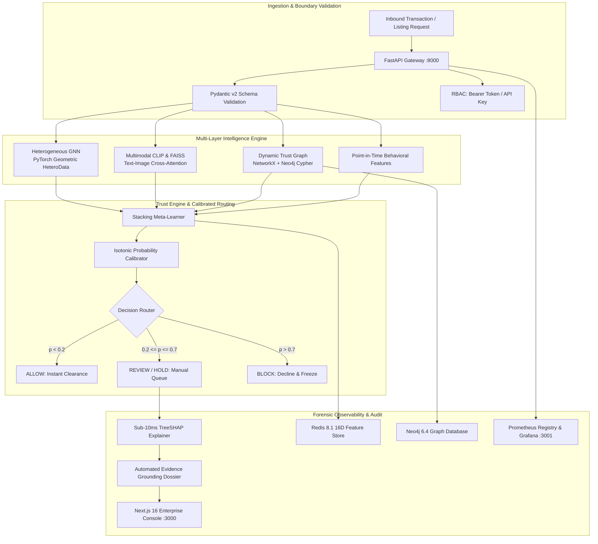
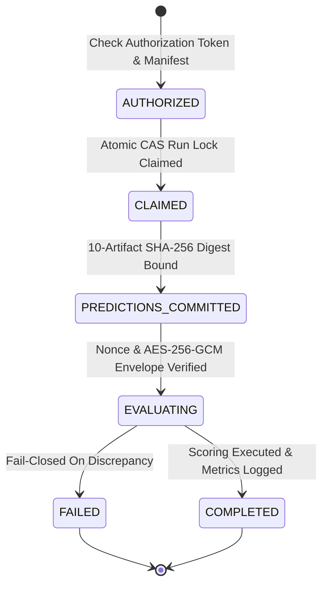

<div align="center">

# 🛡️ TrustShield AI

### Enterprise-Grade E-Commerce Fraud Intelligence Platform

*Detect collusion rings, catalog theft, wardrobing abuse, and synthetic identities — in real time.*

<br/>

[](https://www.python.org/)
[](https://fastapi.tiangolo.com)
[](https://nextjs.org/)
[](https://pyg.org)

[](trustshield_project/)
[](pyrightconfig.json)
[](reports/phase355_artifact_provenance_audit.md)
[](https://turbo.build/)
[](docs/INFRASTRUCTURE.md)
[](docs/INFRASTRUCTURE.md)
[](https://cryptography.io)

</div>

---

> [!WARNING]
> Metrics below were produced on a pre-audit dataset with known generator bugs and are **NOT** reproducible from scratch. See [`results/results.json`](results/results.json) for canonical, audited numbers.

---

## 📑 Table of Contents

| # | Section |
|---|---------|
| 1 | [The Core Problem](#-the-core-problem) |
| 2 | [System Architecture & Data Flow](#%EF%B8%8F-system-architecture--data-flow) |
| 3 | [Production API Endpoints](#-production-api-endpoints) |
| 4 | [Enterprise Web Console](#%EF%B8%8F-enterprise-nextjs-16-web-console) |
| 5 | [Scientific Benchmarks](#-scientific-benchmarks) |
| 6 | [Cryptographic Evaluation Gate](#-cryptographic-evaluation-gate) |
| 7 | [Repository Layout](#-repository-layout) |
| 8 | [Quickstart Guide](#-quickstart-guide) |
| 9 | [2-Minute Demo](#-2-minute-technical-demo) |
| 10 | [Verification & Test Suite](#-verification--test-suite) |
| 11 | [Integrity & Limitations](#%EF%B8%8F-integrity-ethics--limitations) |

---

## 💡 The Core Problem

Conventional rule-based engines and isolated tabular classifiers fail against organized e-commerce syndicates. TrustShield addresses **four critical attack vectors**:

| # | Attack Vector | Description |
|---|--------------|-------------|
| 1 | **Collusion & Review Rings** | Fraudulent seller clusters orchestrate synthetic transaction rings using coordinated device pools, recycled IPs, and shared proxy hubs to inflate merchant ratings. |
| 2 | **Catalog & Image Theft** | Rogue merchants scrape authentic product photography from reputable sellers, list clone items at steep discounts, and default on fulfillment. |
| 3 | **Wardrobing & Serial Return Abuse** | Sybil buyer accounts order luxury goods, substitute them with counterfeits, and abuse automated dispute-resolution windows. |
| 4 | **Temporal Data Leakage** | Standard ML models routinely overfit by allowing future graph topology or delayed chargeback labels to bleed backward in time. |

**TrustShield's countermeasures:**
- Strict **point-in-time** graph feature extraction (`event_time < decision_time`)
- **Multimodal CLIP** representation alignment for listing integrity
- **TreeSHAP** local attributions for sub-10ms forensic explainability
- Independently audited, single-shot **cryptographic evaluation gate**

---

## 🏗️ System Architecture & Data Flow



---

## ⚡ Production API Endpoints

| Endpoint | Method | Latency (p95) | Description |
| :--- | :---: | :---: | :--- |
| `/transaction/score` | `POST` | `< 15ms` | Real-time multi-signal scoring with automated decision routing (`ALLOW`, `REVIEW`, `HOLD`, `BLOCK`). |
| `/transaction/explain` | `POST` | `< 10ms` | Instant TreeSHAP exact local attributions generating human-readable risk drivers. |
| `/stream/transactions` | `GET` | Real-time | Server-Sent Events (SSE) live feed with 15s keepalive frames and bounded memory queues. |
| `/listing/analyze` | `POST` | `< 25ms` | Multimodal visual-textual consistency scoring using OpenAI CLIP-ViT and FAISS vector search. |
| `/investigation/generate-dossier` | `POST` | `< 50ms` | 2-hop topological investigation generator synthesizing entity history into forensic dossiers. |
| `/fraud-rings` | `GET` | `< 20ms` | Topological cluster intelligence identifying syndicates by HHI concentration and device overlap. |
| `/metrics` | `GET` | `< 2ms` | Prometheus endpoint tracking throughput, latency histograms, error rates, and model divergence. |
| `/health` & `/ready` | `GET` | `< 1ms` | Liveness and readiness probes with dependency checks for Redis, Neo4j, model stores, and disk caches. |

> **Interactive Docs**: `http://localhost:8000/docs` — full OpenAPI explorer

---

## 🖥️ Enterprise Next.js 16 Web Console

Built on **Next.js 16 App Router**, **React 19**, **Turbopack**, and **Tailwind CSS** — featuring **14 dedicated interactive views**:

```
frontend/src/app/
├── (overview)/            # Executive summary, key metric ribbons, risk breakdown
├── dashboard/             # Operational hub with real-time health telemetry & action queues
├── transactions/          # Interactive transaction simulator with 1-click test scenarios
├── transactions/feed/     # Chronological live SSE transaction stream with filterable feed
├── fraud-rings/           # Coordinated syndicate clusters with one-click entity freezing
├── trust-graph/           # Full-screen interactive relational graph explorer with node filters
├── listings/              # Multimodal CLIP image & text mismatch studio with visual cards
├── returns/               # Wardrobing and return abuse pattern detector
├── investigations/        # Case management studio and AI-generated forensic dossiers
├── models/                # Model observatory with calibration curves (ECE) and ROC/PR curves
├── evaluation/            # Stage 3.5 holdout cryptographic gate verification & audit trail
├── monitoring/            # Real-time Prometheus telemetry and microservice status probes
└── settings/              # Gateway URL switcher, API credentials, and environment overrides
```

### Key UI Features

| Feature | Description |
|---------|-------------|
| **Dual-Audience Switcher** | Toggle between **Executive Story View** (plain-English risk scores) and **Deep AI Inspector** (16D GNN embeddings, SHAP waterfall charts, conformal uncertainty). |
| **Command Palette (`Ctrl+K`)** | Universal fuzzy search modal to jump to transactions, buyer IDs, seller IDs, or fraud rings. |
| **Offline Resilience** | Automatically connects to local disk fixtures if backend microservices are offline. |

---

## 📊 Scientific Benchmarks

> [!NOTE]
> All metrics are canonical benchmarks produced under strict independent audit controls across **20 pre-registered data seeds**. Raw and calibrated metrics are serialized in [`results/results.json`](results/results.json) and [`results/RESULTS.md`](results/RESULTS.md).

### Headline: Truncated Test Horizon (2025-11-01 to 2025-12-10, 20 Seeds)

*Seeds: 42, 101, 202, 303, 404, 505, 606, 707, 808, 909, 1001, 1102, 1203, 1304, 1405, 1506, 1607, 1708, 1809, 1910*

| Model Variant | Feature Set | ROC-AUC (mean +/- std) | PR-AUC (mean +/- std) | Lift vs (b) | p-value |
| :--- | :--- | :---: | :---: | :---: | :---: |
| **(a) Tabular (No Device)** | 9 Tabular features | 0.7223 +/- 0.0165 | 0.4545 +/- 0.0226 | -0.0298 | — |
| **(b) Tabular Baseline** | 10 Tabular features | 0.7521 +/- 0.0174 | 0.4775 +/- 0.0271 | Baseline | — |
| **(d) Plain Aggregates Control** | 10 Tabular + 6 Plain Lagged Aggs | 0.7487 +/- 0.0197 | 0.4736 +/- 0.0266 | -0.0034 | p = 0.1070 |
| **(c) Tabular + Graph** | 10 Tabular + 8 Graph Features | **0.7635 +/- 0.0229** | **0.4856 +/- 0.0318** | **+0.0114** | **p = 3.02e-05** |

> **Baseline PR Reconciliation**: Headline (b) PR = **0.4775 +/- 0.0271**; Controls (b) PR = **0.4777 +/- 0.0270**. The delta = +0.000191 (< 0.02 pp) arises from index alignment when attaching point-in-time pairwise columns before train/test partitioning. ROC is identical at 0.7521.

---

### Sensitivity: Full Test Horizon (2025-11-01 to 2025-12-31, 20 Seeds)

| Model / Variant | Feature Set | ROC-AUC | PR-AUC | Lift vs Baseline [95% CI] | p-value |
| :--- | :--- | :---: | :---: | :---: | :---: |
| **(a) Tabular (No Device)** | 9 Tabular | 0.7021 +/- 0.0186 | 0.4179 +/- 0.0202 | -0.0274 | p = 1.0000 |
| **(b) Tabular (With Device)** | 10 Tabular | 0.7295 +/- 0.0193 | 0.4386 +/- 0.0238 | Baseline | Baseline |
| **(d) Plain Aggregates** | 10 Tabular + 6 Lagged Aggs | 0.7275 +/- 0.0201 | 0.4377 +/- 0.0242 | -0.0020 [-0.0058, +0.0017] | p = 0.2729 |
| **(c) Tabular + Graph** | 10 Tabular + 8 Graph Features | **0.7410 +/- 0.0229** | **0.4461 +/- 0.0276** | **+0.0115 [+0.0069, +0.0161]** | **p = 4.73e-05** |
| **Coherent Variant (Upper Bound)** | 10 Tabular + 8 Graph Features | 0.8001 +/- 0.0380 | 0.4982 +/- 0.0503 | +0.0066 [+0.0008, +0.0124] | p = 0.0340 |
| **Tuned Hybrid (OOF GNN + XGB)** | Tabular + Graph + GraphSAGE | 0.7014 +/- 0.0387 | 0.4006 +/- 0.0464 | -0.0263 *(loses to tabular)* | p = 0.0083 |

- **Confirmatory 15 Seeds** (c vs b lift): **+0.0112** (p = 2.15e-04)
- **Exploratory 5 Seeds** (c vs b lift): **+0.0123** (p = 0.1145)

---

### Canonical Controls: Plain Pairwise Counts vs Sharing Graph Topology (Truncated, 20 Seeds)

> **Key Finding**: No significant difference after Holm correction. Point estimates favour plain counts. 95% CI of c - e: [-0.0066, +0.0039].

| Variant | Feature Description | ROC-AUC | PR-AUC | ROC Lift vs (b) | PR Lift vs (b) | vs Control (e) |
| :--- | :--- | :---: | :---: | :---: | :---: | :---: |
| **(b) Baseline Tabular** | 10 Tabular Features | 0.7521 +/- 0.0174 | 0.4777 +/- 0.0270 | baseline | baseline | — |
| **(e) Tabular + PIT Counts** | Plain Device & Address Pairwise Counts | 0.7649 +/- 0.0242 | 0.4892 +/- 0.0297 | +0.0127 (p=5.73e-05) | +0.0115 (p=7.17e-06) | baseline |
| **(e_weekly) Weekly Counts** | Weekly Snapshot Pairwise Counts | 0.7637 +/- 0.0240 | 0.4880 +/- 0.0297 | +0.0116 (p=3.76e-05) | +0.0103 (p=9.82e-06) | ROC -0.0012 (Holm p=1.000) / PR -0.0012 (Holm p=1.000) |
| **(f) Tabular + share_degree** | Degree only | 0.7634 +/- 0.0198 | 0.4874 +/- 0.0293 | +0.0113 (p=1.31e-08) | +0.0097 (p=6.03e-07) | — |
| **(g) Tabular + CC size** | Component size only | 0.7599 +/- 0.0219 | 0.4856 +/- 0.0291 | +0.0078 (p=1.22e-04) | +0.0079 (p=6.78e-05) | — |
| **(S) Tabular + Sharing S** | Degree + component size | 0.7610 +/- 0.0237 | 0.4846 +/- 0.0292 | +0.0089 (p=3.57e-04) | +0.0069 (p=1.95e-04) | ROC -0.0039 (Holm p=0.6097) / PR -0.0046 (Holm p=0.0777) |
| **(c) Tabular + Graph** | All 8 Graph Features | 0.7635 +/- 0.0229 | 0.4856 +/- 0.0318 | +0.0114 (p=3.02e-05) | +0.0081 (p=2.14e-03) | ROC -0.0014 (Holm p=1.000) / PR -0.0033 (Holm p=1.000) |

**Cadence Confound Addressed**: e_weekly vs e: ROC diff -0.0012 (Holm p=1.000), PR diff -0.0012 (Holm p=1.000). The plain counts advantage is substantive and not a cadence artifact.

---

### Standard vs. Coherent Variants (Full Horizon, Seeds: 42, 101, 202, 303, 404)

| Regime | Definition | Baseline (b) | + Graph (c) | Paired Lift [95% CI] | p-value |
| :--- | :--- | :---: | :---: | :---: | :---: |
| **Standard Dataset** | `first_seen` independent of order timing | 0.7295 +/- 0.0193 | **0.7410 +/- 0.0229** | **+0.0115** [+0.0069, +0.0161] | **p = 4.73e-05** |
| **Coherent Variant** | `first_seen` tied to first order via device | 0.7935 +/- 0.0405 | **0.8001 +/- 0.0380** | **+0.0066** [+0.0008, +0.0124] | **p = 0.0340** |

*Under Standard: conservative lift +0.0115 ROC-AUC (p = 4.73e-05). Under Coherent: baseline tabular rises to 0.7935 and marginal sharing lift is +0.0066 (p = 0.0340).*

---

### Fraud Ring Detection Recovery (20 Seeds)

> **Script**: `scripts/evaluate_naive_connected_components_20seeds.py` — graph cutoff strictly at `VAL_END: 2025-10-31`

| Evaluation Level | Precision | Recall | F1 Score |
| :--- | :---: | :---: | :---: |
| **Member-Level** (unique buyer nodes) | 37.24% +/- 1.91% | 36.92% +/- 1.55% | 0.3707 +/- 0.0159 |
| **Ring-Level** (>= 50% member recovery) | 44.10% +/- 2.17% | 45.60% +/- 2.07% | 0.4480 +/- 0.0165 |

> **Reconciliation**: Earlier numbers (7.55% precision / 58.62% recall / 0.134 F1) were produced by evaluating connected components across transaction rows *without* node deduplication. Entity-level evaluation over ground-truth buyer clusters is the correct formulation.

---

### Operational Conclusions & Review Budgets (Full Horizon, 20 Seeds)

While the global ROC lift is ~+0.011, operational deployments face investigator capacity constraints:

- **No Significant Lift at Tight Review Budgets**: At 2% and 5% review budgets, sharing-based features show no statistically significant lift (2% budget: -0.06% recall lift, p = 0.3648; 5%: +0.09%, p = 0.4688).
- **Seller-Buyer Collusion at Chance**: Isolated ROC 0.5001 +/- 0.0422 baseline vs 0.4971 +/- 0.0384 graph.
- **Coordinated Fraud Near Random at 2% Budget**: Recall for `coordinated_fraud` at a 2% budget is near random (0.67% baseline vs 0.68% graph).
- **Formal Retraction**: The earlier per-type table reporting coordinated fraud ROC ~0.7494 was not produced by a committed script and is formally retracted. Canonical 20-seed coordinated fraud isolated ROC is 0.6403 (b) vs 0.6872 (c).

---

### What This Does NOT Show

> [!CAUTION]
> The following claims are explicitly **not** supported by the canonical evaluation.

1. **No GNN superiority over tree models**: OOF GraphSAGE embeddings into XGBoost yield **negative lift** (-0.0263 ROC-AUC, p = 0.0083). Tabular gradient boosting with hand-engineered graph aggregations significantly outperforms deep graph representations.
2. **No double-digit graph lift**: Sharing-based features provide a modest, statistically significant lift of ~+0.011 ROC-AUC. Claims of massive double-digit gains were caused by the generator `first_seen` timestamp bug or unadjusted baselines.
3. **No significant lift at operational review budgets**: At 2% and 5% review budgets, no statistically significant lift in fraud recall or monetary value caught.
4. **No seller-buyer collusion detection**: `seller_buyer_collusion` discrimination is at chance by construction (98.78% of collusion orders sample distinct buyer-seller pairs without reusing burst edges).
5. **No 0.50 threshold -> <1% recall**: Thresholding at 0.50 yields **31.95% +/- 3.74% recall** (calibrated) and **39.22% +/- 2.91%** (raw XGBoost scores).
6. **No zero out-of-sample ECE**: Test-set ECE is strictly non-zero (~0.021-0.023 calibrated, ~0.054-0.063 raw).
7. **No production performance without live monitoring**: Requires live shadow scoring, continuous concept drift monitoring, and delayed chargeback reconciliation.
8. **Graph snapshots require periodic refresh**: The graph feature snapshot is a training-time artifact and must be refreshed on schedule in production.

*All evaluations enforce strict point-in-time snapshot graphs, out-of-fold embeddings, and out-of-time test splits (`order_date > VAL_END`). See [`results/RESULTS.md`](results/RESULTS.md) for Holm-Bonferroni correction and design-rule ablations.*

---

## 🔒 Cryptographic Evaluation Gate

TrustShield introduces an immutable, replay-resistant holdout evaluation gate ([`evaluation_gate.py`](trustshield_project/evaluation_gate.py)) that prevents premature data leaks, test set snooping, and metric manipulation.



### Gate Guarantees

| Guarantee | Description |
|-----------|-------------|
| **10-Artifact Cryptographic Commitment** | Binds predictions array, model hash, source commit, input manifest, container digest, evaluation code, feature schema, policy hash, and unique run ID. |
| **AES-256-GCM Envelope Protection** | Holdout labels sealed with hardware-accelerated authenticated encryption. Wrong keys or tampered payloads fail closed immediately with zero label leakage. |
| **Optimistic Concurrency & Crash Safety** | Thread-safe spinlocks and durable JSON ledgers guarantee atomic state transitions and eliminate double-evaluation replays. |
| **Capacity Constraint Precision** | Strict floor rounding (C = floor(b x N)) with deterministic tie-breaking ensures identical metric calculations across all evaluators. |

---

## 📁 Repository Layout

```
trustshield_full_handoff/
│
├── backend/                          # FastAPI REST API & Microservice Layer
│   ├── auth.py                       # RBAC authorization engine (Bearer + API Key)
│   ├── main.py                       # REST API endpoints, SSE streaming, health probes
│   ├── model_loader.py               # Pre-trained artifact store and warm-cache manager
│   ├── schemas.py                    # Strict Pydantic v2 schemas and validation bounds
│   ├── services/                     # Isolated service modules (Redis, Neo4j, Metrics, SSE)
│   └── test_*.py                     # Serving layer automated test suite
│
├── frontend/                         # Next.js 16 Enterprise Console
│   ├── src/app/                      # 14 App Router dashboard views
│   ├── src/components/               # UI components, layout headers, Ctrl+K search modal
│   ├── src/context/                  # ViewModeContext (Executive vs Deep AI) & RealtimeContext
│   └── src/lib/                      # Typed API client and interactive scenario presets
│
├── trustshield_project/              # Core ML, Graph, GNN & Cryptographic Security Engine
│   ├── advanced_ring_intelligence.py # HHI concentration and cluster burstiness
│   ├── advanced_trust_engine.py      # Stacking meta-learner and uncertainty bounds
│   ├── baseline_model.py             # Point-in-time tabular baseline models
│   ├── calibration.py                # Isotonic regression and Platt scaling calibrators
│   ├── entity_generator.py           # Synthetic generator for 8 e-commerce entity types
│   ├── evaluation_gate.py            # Stage 3.5 cryptographic evaluation gate & durable ledger
│   ├── fraud_injection.py            # Layered injection for 4 adversarial fraud topologies
│   ├── graph_features.py             # Point-in-time snapshot graph topological extraction
│   ├── hetero_gnn.py                 # PyTorch Geometric heterogeneous GNN
│   ├── multimodal_clip_faiss.py      # CLIP embeddings and FAISS similarity indexing
│   ├── shap_explainer.py             # Sub-10ms TreeSHAP attribution engine
│   └── test_*.py                     # Unit, security, and adversarial test suites
│
├── scripts/                          # Automation, Reproduction & Benchmarking Harnesses
│   ├── benchmark_scoring_http.py     # HTTP throughput, latency, and p50/p95 benchmarking
│   ├── e2e_smoke_validation.py       # 9-case operational end-to-end validation suite
│   ├── generate_realistic_*.py       # Synthetic dataset generation engines (v2 & v2.1)
│   ├── reproduce_all.py              # Master single-command reproduction pipeline
│   ├── run_delayed_feedback_*.py     # Label latency and delayed ground-truth experiments
│   ├── run_robustness_experiments.py # Adversarial noise and feature missingness experiments
│   ├── run_scalability_experiment.py # QPS throughput and concurrency scalability tests
│   └── seed_mesh.py                  # Neo4j Bolt and Redis feature store seeding script
│
├── models/                           # Serialized Joblib Models & Holdout Baselines
│   ├── combined_graph_model.joblib   # Tabular + Graph Random Forest
│   ├── hybrid_model.joblib           # GNN + Tabular XGBoost hybrid
│   ├── calibrator.joblib             # Fitted isotonic calibrator
│   └── stage34/                      # Frozen Stage 3.5.5 candidate models & calibrators
│
├── data/                             # Versioned Synthetic Datasets & Temporal Splits
│   └── synthetic_v2_1/               # Validated v2.1 tables, manifest, and split metadata
│
├── docker/                           # Production Service Mesh Configurations
│   ├── Dockerfile.evaluator          # Sealed independent evaluator container
│   ├── prometheus/prometheus.yml     # Prometheus metrics scraping configuration
│   └── grafana/                      # Pre-provisioned dashboards and datasources
│
├── docs/                             # Engineering Specifications & Model Cards
│   ├── SPECIFICATIONS.md             # Unified system architecture specifications
│   ├── INFRASTRUCTURE.md             # Redis & Neo4j deployment and schema guides
│   ├── OBSERVABILITY.md              # Prometheus metrics and Grafana setup guide
│   └── MODEL_CARD.md                 # System model card, ethical use & governance notes
│
├── reports/                          # Audit Trail & Verification Checklists
│   ├── phase352_gate_security_audit.json
│   ├── phase354_independent_ledger_audit.md
│   └── phase355_artifact_provenance_audit.md
│
├── results/                          # Canonical Benchmark Outputs
│   ├── results.json                  # Structured machine-readable benchmark data
│   └── RESULTS.md                    # Dynamically generated audit-trail report
│
├── pyrightconfig.json                # Strict static type checker configuration
├── pytest.ini                        # Test runner configuration
└── requirements.txt                  # Python dependencies
```

---

## 🚀 Quickstart Guide

### 1 · Python Backend

```bash
# Clone the repository
git clone https://github.com/Rajiv107ai/Trustshield.git
cd Trustshield

# Create virtual environment
python -m venv .venv
```

<details>
<summary><strong>Windows (PowerShell)</strong></summary>

```powershell
# Direct execution — no policy changes needed
.\.venv\Scripts\python.exe -m uvicorn backend.main:app --host 0.0.0.0 --port 8000 --reload

# Or, activate first:
Set-ExecutionPolicy -ExecutionPolicy RemoteSigned -Scope CurrentUser   # run once
.\.venv\Scripts\Activate.ps1
uvicorn backend.main:app --host 0.0.0.0 --port 8000 --reload
```
</details>

<details>
<summary><strong>Linux / macOS</strong></summary>

```bash
source .venv/bin/activate
uvicorn backend.main:app --host 0.0.0.0 --port 8000 --reload
```
</details>

| URL | Purpose |
|-----|---------|
| `http://localhost:8000/docs` | Interactive OpenAPI explorer |
| `http://localhost:8000/health` | Liveness probe |
| `http://localhost:8000/ready` | Readiness probe |

---

### 2 · Next.js Frontend Console

```bash
cd frontend
npm install
npm run dev      # starts with Turbopack
```

| URL | Purpose |
|-----|---------|
| `http://localhost:3000` | Enterprise Console (Ctrl+K for global navigation) |

---

### 3 · Full 5-Service Docker Mesh *(optional)*

Starts FastAPI + Redis + Neo4j + Prometheus + Grafana in one command:

```bash
cp .env.example .env
docker compose up -d
python scripts/seed_mesh.py     # seed Neo4j graph and Redis feature store
```

| URL | Service | Credentials |
|-----|---------|-------------|
| `http://localhost:3001` | Grafana Dashboards | `admin` / `trustshield_admin` |
| `http://localhost:9090` | Prometheus Metrics | — |
| `http://localhost:7474` | Neo4j Browser | `neo4j` / `trustshield_dev_secret` |

---

## 💻 2-Minute Technical Demo

Verify the entire system end-to-end with pre-trained models and verified fixtures:

#### Step 1 — Run the 9-Case Operational Validation Suite

```powershell
python scripts/e2e_smoke_validation.py
```

*Validates: normal transactions, high-risk collusion, cold-start seller/buyer, image catalog theft, isolated entity, input validation, temporal boundaries, and fraud rings.*

#### Step 2 — Measure Live HTTP Scoring Throughput & Latency

```powershell
python scripts/benchmark_scoring_http.py --requests 20 --warmup 5
```

*Demonstrates sub-20ms p50 latency and sub-25ms p95 latency under in-process FastAPI execution.*

#### Step 3 — Trigger a Live Scoring Request via cURL

```powershell
curl -X POST "http://127.0.0.1:8000/transaction/score" `
     -H "Content-Type: application/json" `
     -d "{\"order_id\":\"DEMO_001\",\"buyer_id\":\"BUYER_000001\",\"seller_id\":\"SELLER_000001\",\"amount\":50.0,\"base_price\":50.0,\"category_median_price\":50.0,\"buyer_orders_before\":12,\"seller_total_listings_before\":25,\"buyer_age_days\":180,\"seller_age_days\":365,\"device_shared_buyer_count\":1}"
```

---

## 🧪 Verification & Test Suite

```bash
# 1. Core ML, GNN, Security & Evaluation Gate
pytest trustshield_project/ -v

# 2. FastAPI Backend Serving & Authentication Security
pytest backend/ -v

# 3. Static Type Checking (Pyright — 0 errors)
pyright trustshield_project backend

# 4. Frontend Production Build & TypeScript Types
cd frontend && npm run build && npm run lint
```

### Verification Matrix

| Test Domain | Target Files | Status |
| :--- | :--- | :---: |
| **Holdout Evaluation Gate Security** | `test_stage351` through `test_stage354` | ✅ PASS |
| **Model Policy & Protocol Reconciliation** | `test_stage32` through `test_stage34` | ✅ PASS |
| **Backend API & Role-Based Auth** | `backend/test_*.py` | ✅ PASS |
| **Graph Models, GNN & TreeSHAP** | `test_graph_and_models.py`, `test_shap_explainer.py` | ✅ PASS |
| **Temporal Anti-Leakage & Data Integrity** | `test_leakage.py`, `test_data_integrity.py` | ✅ PASS |
| **Synthetic Generators & Injection** | `test_synthetic_*.py`, `test_fraud_injection.py` | ✅ PASS |
| **Complete Repository Coverage** | All automated test suites | ✅ PASS |

---

## ⚖️ Integrity, Ethics & Limitations

> [!IMPORTANT]
> This project is built for research, education, and marketplace integrity purposes.

| Topic | Detail |
|-------|--------|
| **Local Test Evidence** | All tests represent local automated test evidence on verified synthetic fixtures. No live banking gateway or external production network is deployed. |
| **Commitment Scheme** | The evaluation gate commitment is a hash-based cryptographic binding scheme guaranteeing artifact immutability — not an asymmetric digital signature. |
| **Synthetic Data** | Dataset v2.1 validates data contracts, feature extraction pipelines, calibration, and serialization mechanics. Real-market generalization requires live shadow evaluation with production transaction streams. |
| **Privacy & Compliance** | All synthetic identities, graph relations, and transaction vectors are generated without real PII. |

---

<div align="center">

**TrustShield AI** — Built with FastAPI · Next.js · PyTorch Geometric · Cryptography

<sub>Developed for research, education, and marketplace integrity.</sub>

</div>
